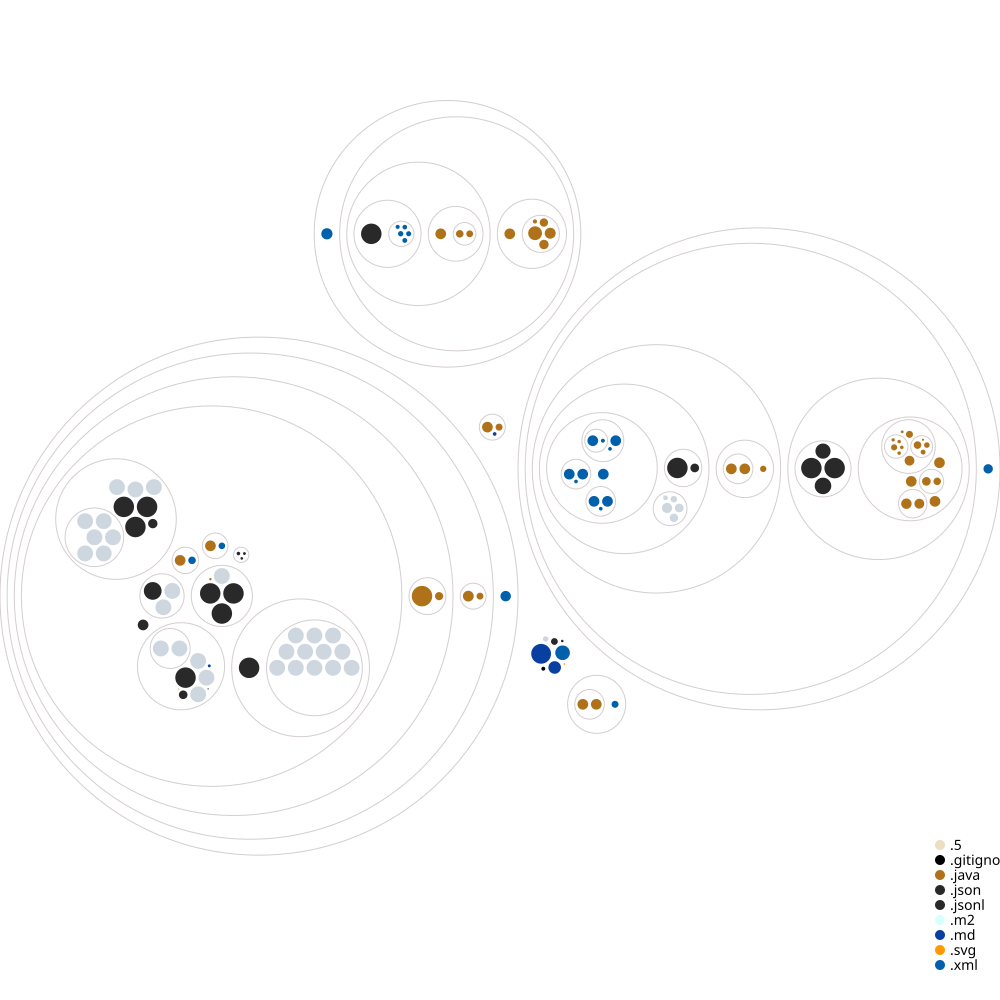

# sbom.exe

A tool to illustrate termination of Java virtual machine if a
prohibited method is invoked.
Checkout the README on that branch for instructions.

## [Visualization by GitHub Next](https://githubnext.com/projects/repo-visualization/)

## Project structure

The project has two concepts - generating fingerprints and watching for
prohibited classes.

## Generation of fingerprints

The fingerprints are generated using the `classfile-fingerprint` CLI.

It has three subcommands.
All the commands take in the following parameters:

**Required Parameters**

|      Parameter      |  Type  | Description                                                                               |
|:-------------------:|:------:|-------------------------------------------------------------------------------------------|
| `output` or `input` | `File` | Path to index file. `output` will create a  new file. `input` will merge the indices. |

1. `jdk`: Record a digest of a JDK. Run it once per JDK that the application may run on. |
    - **Optional Parameters**

      |   Parameter   |  Type  | Description                                                   |
      |:-------------:|:------:|---------------------------------------------------------------|
      | `java-home`   | `File` | The JDK to digest. Defaults to the JDK that runs the indexer. |

2. `supply-chain`: Generate fingerprints for all the dependencies captured in
   the SBOM.
    - **Required Parameters**

      | Parameter |  Type  | Description            |
      |:---------:|:------:|------------------------|
      |  `sbom`   | `File` | Path to the sbom file. |

      > `sbom` could be CycloneDX 1.5 or 1.6 JSON document.

3. `runtime`: Generate fingerprints for all the classes loaded at runtime.
    - **Required Parameters**

      | Parameter |  Type   | Description                                                      |
      |:---------:|:-------:|------------------------------------------------------------------|
      | `project` | `File`  | Path to the project.                                             |
      |     `executable-jar-module`      | `String` | The module  (`artifactID`)that generates the executable jar. |

    - **Optional Parameters**

      | Parameter |  Type  | Description             |
      |:---------:|:------:|-------------------------|
      |  `cleanup`   | `File` | Delete the temporary project after the process. |

## Watching for prohibited classes

The `watchdog-agent` is a Java agent that watches for prohibited classes.

It takes in the following parameters:

**Required Parameters**

| Parameter |  Type  | Description             |
|:---------:|:------:|-------------------------|
|  `sbom`   | `File` | Path to the index file. |

**Optional Parameters**

|   Parameter    |   Type    | Description                                                                             |
|:--------------:|:---------:|-----------------------------------------------------------------------------------------|
| `skipShutdown` | `boolean` | If `true`, the JVM will not shutdown if a prohibited class is loaded. Default: `false`. |
